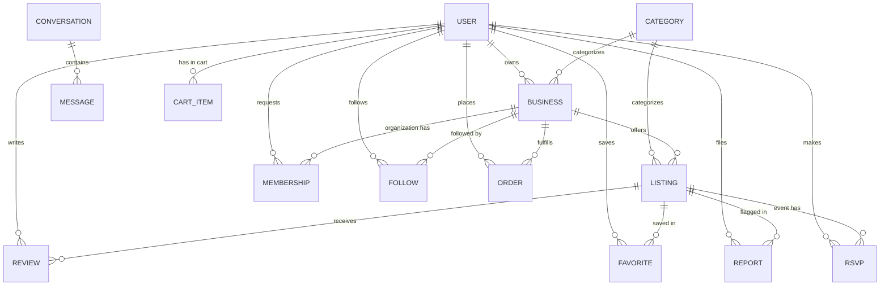

# Bento data model (Firestore)

Firestore collections for Bento, based on the ERD (`BentoERD.drawio.pdf`) plus the collections
needed by requirements and use cases the ERD doesn't cover.

✅ security rules written · ⬜ no rules yet. A collection without rules is locked: nobody can
read or write it until its rules are added to `firestore.rules`.

## Conventions

- **One collection per entity.** A foreign key is stored as the other document's ID string
  (e.g. `owner_id: "<uid>"`).
- **Field names use `snake_case`,** matching the ERD.
- **Timestamps** are set with `serverTimestamp()` in the app. The rules check that
  `created_at` / `updated_at` equal the server time, so they can't be faked.
- **Some fields are copied onto other documents on purpose** (e.g. `owner_id` and
  `business_type` on a listing). Firestore can't join collections, so copying them lets one
  query handle each filter and lets the rules check ownership without extra reads.
- **Join documents use predictable IDs** (e.g. favorites are `{user_id}_{listing_id}`). That makes
  duplicates impossible and lets the app check "is this saved?" with one read.

## Overview



## Changes from the ERD

| # | Change | Why |
|---|---|---|
| 1 | `USER.role` values are now `student`, `owner`, `organization`, `admin` | FR-1.4 lists four roles; the ERD had three |
| 2 | `BUSINESS` gets a `type` field: `business` or `organization` | Clubs and businesses share one collection; FR-2.1, FR-4.2 |
| 3 | `REVIEW` points at `listing_id` (and keeps `business_id` as a copy) | FR-5.1 says reviews are for a listing |
| 4 | `LISTING_PHOTO` becomes a `photos` array on `LISTING` | Loads in one read (NFR-4.2); array order replaces `sort_order` |
| 5 | Events are listings with `type: "event"` plus `event_start` / `event_end` | FR-7 reuses search, favorites, reviews and reports |
| 6 | `LISTING` gets `owner_id`, `category_id`, `business_type`, `title_lower`, `keywords`, `location`, `updated_at` | Filters (FR-4.2), keyword search (FR-4.1), owner-only rules (NFR-6.3) |
| 7 | `LISTING.status` adds `removed` | Lets an admin take a listing down without deleting the evidence (FR-8.4) |
| 8 | `REPORT.reason` is a fixed list | FR-8.2 requires choosing a reason |
| 9 | New: RSVP, MEMBERSHIP, FOLLOW, CONVERSATION/MESSAGE, NOTIFICATION, CART_ITEM, ORDER, ACTIVITY | Use cases and FR-7.3, 9, 10, 11, 12 |

---

## Core collections

### `users/{user_id}` ✅

Document ID = Firebase Auth `uid`. Created at sign-up by `public/js/auth.js`.

| Field | Type | Notes |
|---|---|---|
| `name` | string | |
| `gsu_email` | string | Lowercase; must match the signed-in email |
| `role` | string | `student` · `owner` · `organization` · `admin` |
| `is_verified` | bool | Copied from Firebase email verification |
| `profile_photo_url` | string \| null | Storage path `users/{uid}/profile/...` |
| `created_at` | timestamp | |

Rules: everyone starts as `student`. A user can switch themselves between `student`, `owner`
and `organization`, which the app does when they create a business or club. Only an admin can
grant or remove `admin`. Ownership of a business is checked with `owner_id`, never with the role.

### `categories/{category_id}` ✅

| Field | Type | Notes |
|---|---|---|
| `name` | string | e.g. "Beauty", "Photography", "Food", "Art" (FR-2.4) |
| `description` | string | |

Use readable IDs (`beauty`, `photography`, `food`, `art`, `tutoring`, `clubs-social`, ...) so they're
easy to filter on. Only admins can write categories. Seed them by hand in the Firestore console.

### `businesses/{business_id}` ✅

One collection for business **and** organization profiles (FR-2).

| Field | Type | Required | Notes |
|---|---|---|---|
| `owner_id` | string | ✔ | USER id. Can't be changed |
| `type` | string | ✔ | `business` or `organization` |
| `category_id` | string | ✔ | Must be an existing category |
| `name` | string | ✔ | 1–80 characters |
| `name_lower` | string | | `name.toLowerCase()`, for search |
| `description` | string | | ≤ 2000 characters |
| `location` | string | | ≤ 200, e.g. "Student Center East" |
| `contact_info` | string | | ≤ 200 |
| `logo_url` | string \| null | | FR-2.3. Storage path `users/{uid}/businesses/{business_id}/...` |
| `status` | string | ✔ | `active` · `suspended`. Created as `active`; only an admin can change it |
| `created_at` | timestamp | ✔ | |
| `updated_at` | timestamp | | |

Who can do what:

| Action | Who |
|---|---|
| See an `active` profile | Any verified student |
| See a `suspended` profile | The owner and admins |
| Create | Any verified student, with `owner_id` set to themselves |
| Edit | The owner; `owner_id`, `status` and `created_at` can't change |
| Suspend or reactivate | Admin |
| Delete | The owner or an admin |

### `listings/{listing_id}` ✅

Products, services and events (FR-3, FR-7).

| Field | Type | Required | Notes |
|---|---|---|---|
| `business_id` | string | ✔ | Must be an **active** business you own. Can't be changed |
| `owner_id` | string | ✔ | Copy of the business owner. Can't be changed |
| `business_type` | string | ✔ | Copy of `businesses.type`, for the type filter (FR-4.2) |
| `category_id` | string | ✔ | Must exist (FR-4.2) |
| `type` | string | ✔ | `product` · `service` · `event`. Only organizations can post events (FR-7.1) |
| `title` | string | ✔ | 1–100 characters |
| `title_lower` | string | ✔ | Must equal `title` in lowercase |
| `keywords` | string[] | | ≤ 30 lowercase words, for keyword search (FR-4.1), see below |
| `description` | string | | ≤ 4000 |
| `price` | number | ✔ | 0–100000. Use 0 for free events |
| `availability` | string | | ≤ 500, e.g. "Weekdays after 3pm" (FR-3.3) |
| `location` | string | | ≤ 200 |
| `photos` | string[] | | ≤ 10 Storage URLs; the first one is the cover photo (FR-3.2, NFR-1.2) |
| `event_start` | timestamp | events only | Required when `type == "event"` (FR-7.2) |
| `event_end` | timestamp \| null | | Must be after `event_start` |
| `status` | string | ✔ | `active` · `hidden` · `removed` |
| `created_at` | timestamp | ✔ | |
| `updated_at` | timestamp | ✔ | Set on every write |

Who can do what:

| Action | Who |
|---|---|
| See an `active` listing | Any verified student |
| See a `hidden` or `removed` listing | The owner and admins |
| Create | The owner of an active business. `status` must be `active` or `hidden` |
| Edit | The owner, unless an admin removed it. The owner can switch between `active` and `hidden` (FR-3.4) |
| Remove for a policy violation | Admin, by setting `status: "removed"`; admins can only change `status` and `updated_at` (FR-8.4) |
| Delete | The owner or an admin |

**Queries:** security rules check each query, but they don't filter the results. A browse query must include `where("status", "==", "active")`.
Without it, the query is refused because it *could* return hidden listings. An owner's
"my listings" page queries `where("owner_id", "==", uid)`.

**Keyword search (FR-4.1).** Firestore has no full-text search. Store `keywords` and query with
`where("keywords", "array-contains", word)`:

```js
// Unique lowercase words from the title and category, max 30.
export function makeKeywords(title, categoryName = "") {
  const words = `${title} ${categoryName}`.toLowerCase().match(/[a-z0-9]+/g) || [];
  return [...new Set(words)].filter((w) => w.length > 1).slice(0, 30);
}
```

This matches whole words only: "braids" finds "Box braids", "brai" doesn't.

**Uploading photos.** Create the listing first so it has an ID. Upload photos to
`users/{uid}/listings/{listing_id}/{file}`, then save the download URLs into `photos`.

### `reviews/{review_id}` ⬜

Doc ID `{user_id}_{listing_id}`, so each user gets one review per listing (FR-5).

| Field | Type | Notes |
|---|---|---|
| `user_id` | string | Author |
| `listing_id` | string | |
| `business_id` | string | Copy, for the business owner's "view reviews" page |
| `rating` | int | 1–5 |
| `comment` | string | ≤ 2000 |
| `created_at` | timestamp | |

Average rating (FR-5.2): store `rating_sum` and `rating_count` on the listing and update them in a
transaction whenever a review is added. The page shows `rating_sum / rating_count`.

### `favorites/{favorite_id}` ⬜

Doc ID `{user_id}_{listing_id}` (FR-6). Fields: `user_id`, `listing_id`, `created_at`.
To list a user's favorites, query `where("user_id", "==", uid)`.

### `reports/{report_id}` ⬜

| Field | Type | Notes |
|---|---|---|
| `reporter_id` | string | |
| `listing_id` | string | |
| `reason` | string | `fake` · `scam` · `inappropriate` · `prohibited_item` · `spam` · `other` (FR-8.2) |
| `details` | string | Required when `reason == "other"` |
| `status` | string | `open` · `resolved` |
| `reviewed_by` | string \| null | Admin's user ID |
| `resolution` | string \| null | `removed` · `dismissed` |
| `created_at` | timestamp | |

Only the reporter and admins can read a report.

---

## New collections (not in the ERD yet)

### `rsvps/{rsvp_id}` ⬜

Doc ID `{listing_id}_{user_id}` (FR-7.3). Fields: `listing_id`, `user_id`, `created_at`.
Keep an `rsvp_count` on the event listing if the page shows "23 going".

### `memberships/{membership_id}` ⬜

Doc ID `{business_id}_{user_id}`. Covers "Request club membership" and "Review and approve club
membership requests" (FR-10).

| Field | Type | Notes |
|---|---|---|
| `business_id` | string | Must have `type == "organization"` |
| `user_id` | string | |
| `status` | string | `pending` · `approved` · `rejected` |
| `requested_at` | timestamp | |
| `decided_at` | timestamp \| null | |

A user creates a `pending` request. Only the organization's owner can approve or reject it.
"Organizations I've joined" (FR-10.2) queries `user_id == uid` and `status == "approved"`.

### `follows/{follow_id}` ⬜

Doc ID `{user_id}_{business_id}`. Covers "Connect with / follow profiles". Fields: `user_id`,
`business_id`, `created_at`.

### `conversations/{conversation_id}` and `conversations/{id}/messages/{message_id}` ⬜

Covers chat and FR-9.

`conversations`: `participant_ids` (string[2]), `business_id`, `listing_id` (the listing it started
from, may be null), `last_message` (string), `last_message_at` (timestamp), `unread_by` (string[]).

`messages`: `sender_id`, `text` (≤ 2000), `created_at`.

Only participants can read or write. FR-9.2 notifications: when a message is sent, add the other
person to `unread_by` and show a badge for it.

### `notifications/{notification_id}` ⬜

`user_id`, `type` (`message` · `membership` · `review` · `report`), `text`, `link`, `read` (bool),
`created_at`.

### `users/{user_id}/cart/{listing_id}` ⬜

FR-12.1. Stored under the user. Fields: `listing_id`, `business_id`, `quantity` (int ≥ 1), `added_at`.
Read the price from the listing at checkout, never from the cart.

### `orders/{order_id}` ⬜

FR-12.2.

| Field | Type | Notes |
|---|---|---|
| `buyer_id` | string | |
| `business_id` | string | |
| `owner_id` | string | Copy, so the seller can query their orders |
| `items` | array of maps | `{listing_id, title, price, quantity}`, copied at checkout |
| `total` | number | |
| `status` | string | `pending` · `paid` · `fulfilled` · `cancelled` |
| `payment_ref` | string \| null | Stripe payment ID, or null for a simulated checkout |
| `created_at` | timestamp | |

A Cloud Function or a transaction creates the order and calculates `total`, so a user can't set
their own price.

### `users/{user_id}/activity/{activity_id}` ⬜

For recommendations (FR-11). Fields: `kind` (`view` · `favorite` · `rsvp` · `search`),
`listing_id`, `category_id`, `created_at`. A simple first version: recommend active listings in
the user's three most common categories that they haven't favorited.

---

## Indexes

`firestore.indexes.json` has composite indexes for these queries:

| Query | Used for |
|---|---|
| `status == active`, `category_id ==`, newest first | Browse by category |
| `status == active`, `business_type ==`, newest first | Business / organization filter |
| `status == active`, `type ==`, newest first | Events, products or services |
| `status == active`, `keywords array-contains`, newest first | Keyword search |
| `status == active`, `price` range | Price filter |
| `owner_id ==`, newest first | "My listings" |
| `status == active`, `business_id ==`, newest first | A business's public profile page |

If a query fails with "The query requires an index", the error message includes a link that
creates the index. Click it, then copy the new index into `firestore.indexes.json` so it's in Git.

## Storage (photos)

`storage.rules` lets verified students view images, and lets a user upload only under
`users/{their uid}/...`. Uploads must be JPEG, PNG or WebP and under 5 MB.

Firebase Storage requires the Blaze (pay-as-you-go) plan. Once Storage is enabled
(Build → Storage → Get started), add this to `firebase.json` so the rules deploy with everything else:

```json
"storage": { "rules": "storage.rules" }
```

Until then, deploy only the Firestore rules: `firebase deploy --only firestore`.
